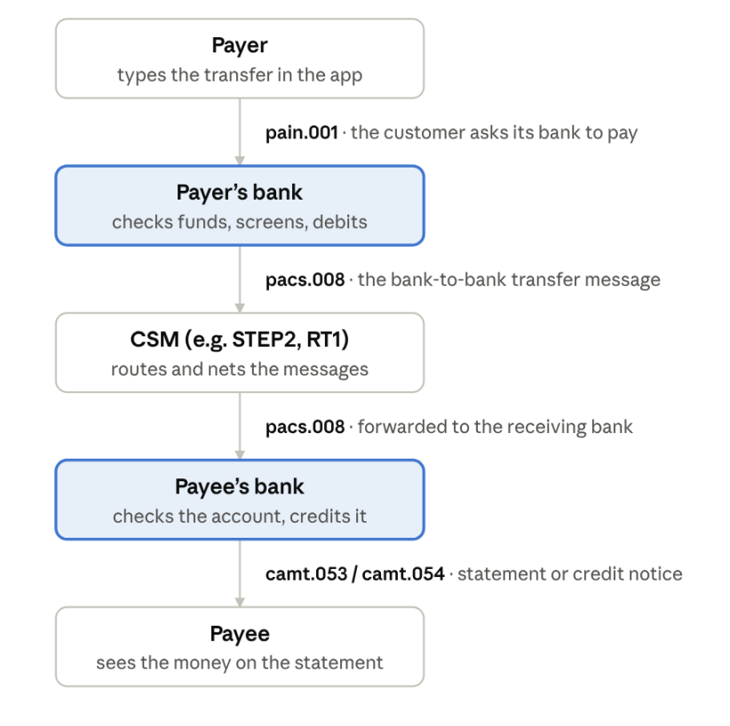

# SEPA (Single Euro Payments Area)

- SEPA gave every account in Europe
  - One account format (the `IBAN`)
  - One message language (`ISO 20022`)
  - One `rulebook` per scheme

- A transfer to another country within EU now works exactly like a domestic one
- SEPA covers the `EU` and `EEA` countries plus a few neighbors such as Switzerland, the UK and Monaco
- Its rulebook were written by the `European Payments Council (EPC)`

## Three layers

> A payment is an `instruction` plus a `settlement`, governed by a `scheme` (three layers)

- `Scheme`: The rulebook: message formats, deadlines, who is liable for what
- `Clearing`: Exchanging, checking and netting payment instructions between PSPs
- `Settlement`: The final, irrevocable transfer of money between PSPs

## Actors

- **Debtor** (Payer)
- **Creditor** (Payee)

- **Payment service provider (PSP)**: the institution that holds an account (e.g., the bank)
  - Can be a `1. credit institution (bank)`, `2. payment institution` or `3. e-money institution`

- **Clearing and settlement mechanism (CSM)**
  - The hub through which PSPs exchange money
  - `STEP2` for the EU, `STET` for France
  - Smaller PSP often reach to CSM through a partner bank (e.g., Arkea?)
  - When Debtor and Creditor are in same PSP, the CSM part is skipped and money is moved in the PSPs own books (`book transfer`)

- **Settlement system**
  - Where PSPs pay each other in central-bank money
  - `T2` (aka `TARGET2`) for euro. It's run by the Eurosystem

## SEPA schemes

- `SCT (SEPA Credit Transfer)`
  - Push
  - At most 1 business day
  - Common Usage: Paying suppliers and salaries

- `SCT Inst (Instant Credit Transfer)`
  - Push
  - Under 10 seconds, 24/7
  - Urgent payments

- `SDD Core (Direct Debit)`
  - Pull
  - Settles on the due date
  - Subscriptions, utilities

- `SDD B2B (Direct Debit, business to business)`
  - Pull
  - Settles on the due date
  - Supplier invoices between businesses

## ISO 20022 Protocol

- A standard XML format
- Every SEPA PSP understands

• `pain` (payment initiation): a customer talking to its PSP.
• `pacs` (payment clearing and settlement): a PSP talking to a CSM or to another PSP.
• `camt` (cash management): statements and notifications back to the customer.

