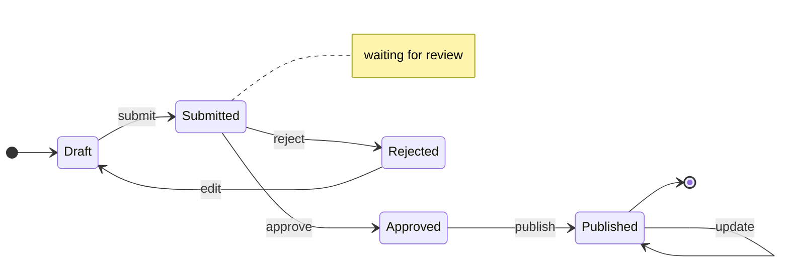
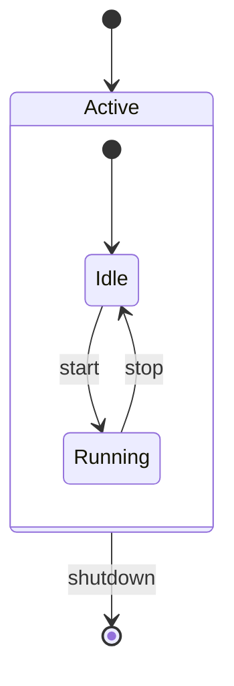
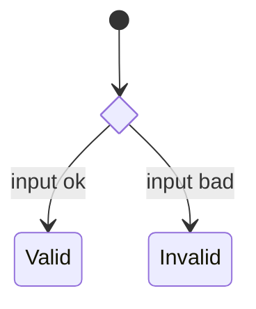

# State Diagram

## Syntax

- `[*] --> A`: start state
- `A --> [*]`: end state
- `A --> B`: transition
- `A --> B: event`: transition with a label
- `A --> A: event`: self-transition
- `note right of A: text`: note (`left of` also works)

## Directions

- `direction LR`: left-to-right
- `direction TB`: top-to-bottom (default)

## Composite states

## Choice

